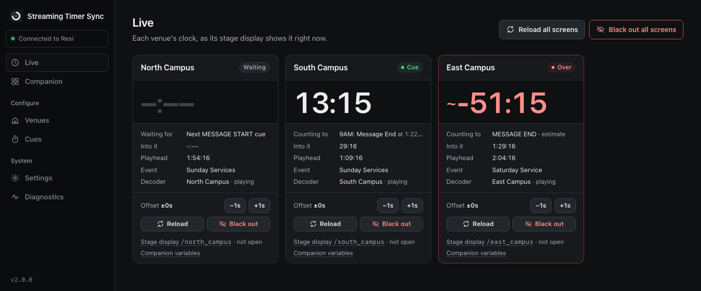
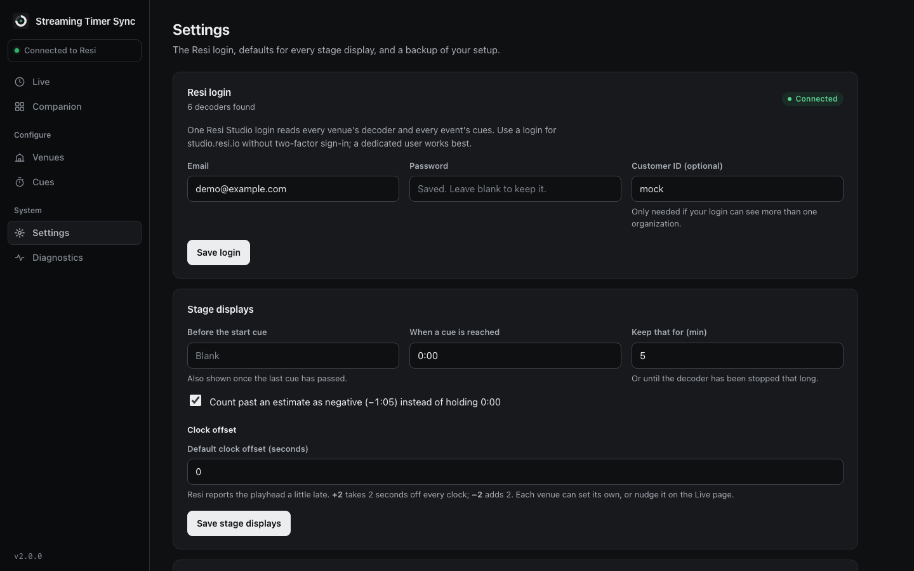
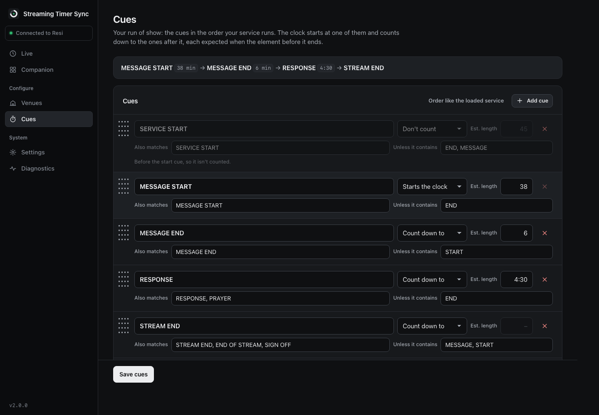
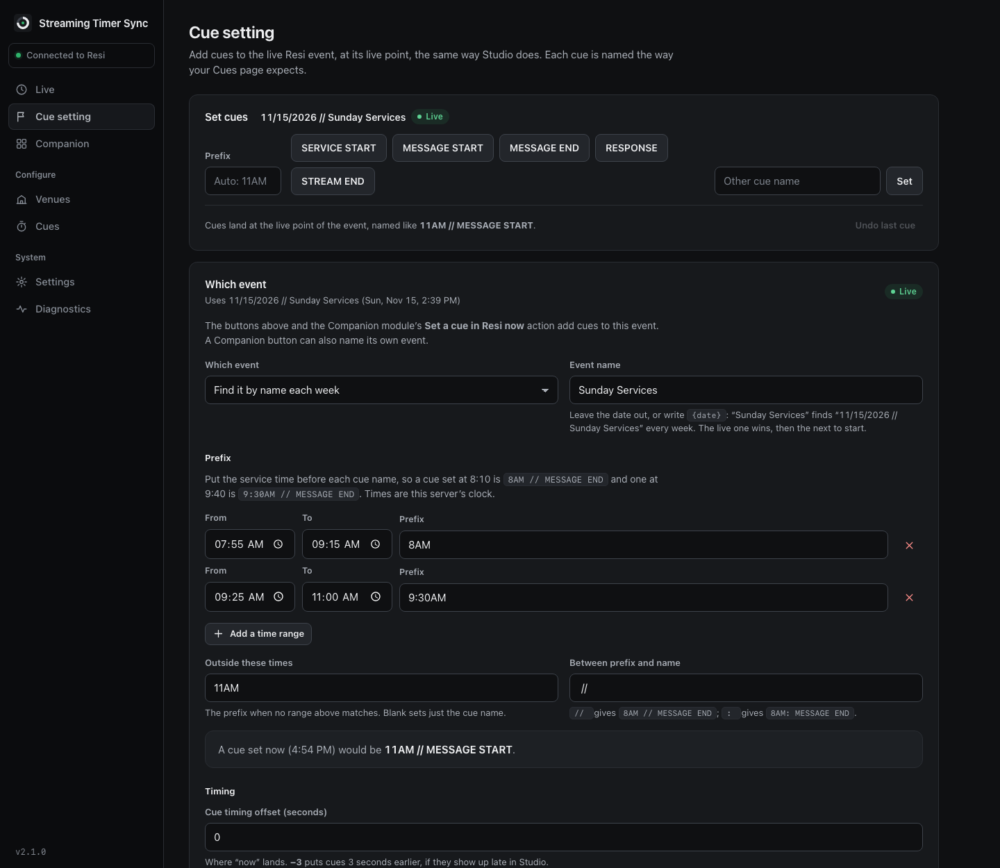
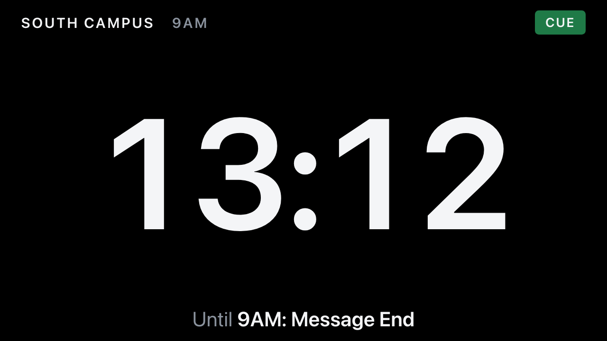
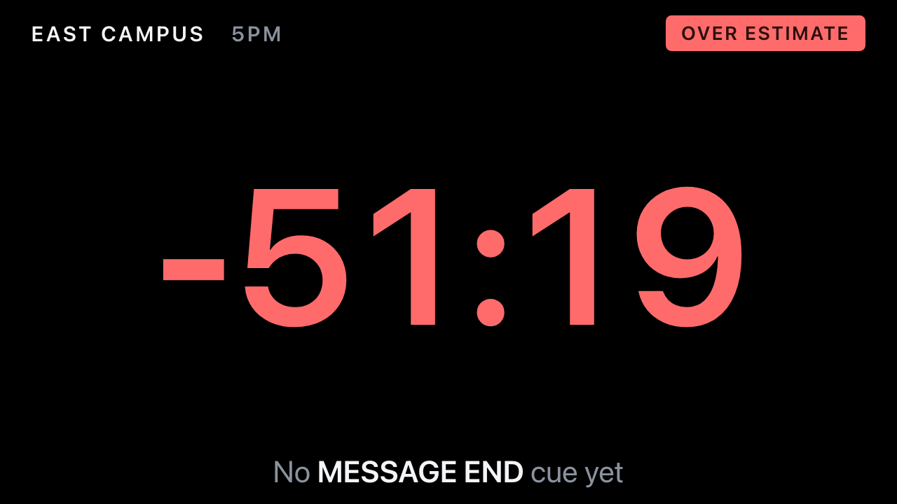
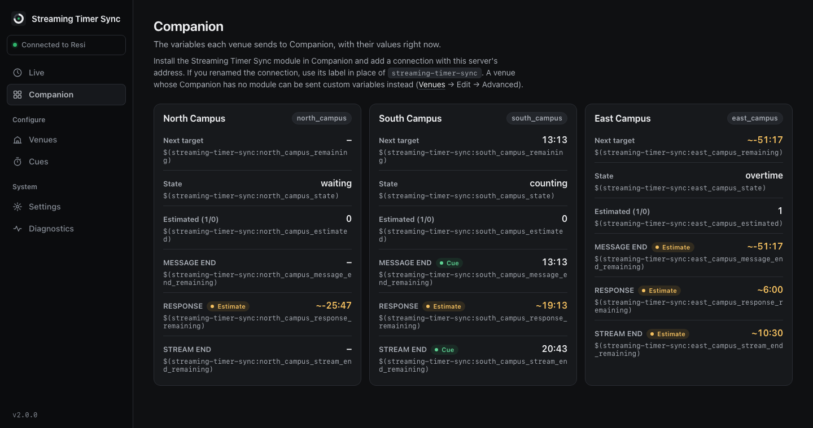

<p align="center"></p>

<h1 align="center">Streaming Timer Sync</h1>

<p align="center">Countdown clocks for your stage displays, driven by your Resi decoders and the cues in your events.</p>

<p align="center"></p>

Each venue shows how long is left until the next moment in your service: the end of the message, the response, the end of the stream. It reads where that venue's Resi decoder actually is in the event, so the clock is right whether the venue is watching live, running a few minutes behind, or playing back an earlier service.

- **A full-screen stage display per venue**, for a ProPresenter web element or any browser.
- **Your run of show**: put your cues in service order, give each an estimated length, and the clock counts through them.
- **Known or estimated, always labelled**: a real cue gives a known time; until it exists, the clock counts to an estimate and says so.
- **Forgiving cue names**: `9AM // Message Start`, `9:30 - msg begins` and `MESAGE START` all count as the same cue.
- **Set cues live**: one press on the dashboard or a Stream Deck adds a correctly named cue to the live Resi event, with the service time as its prefix.
- **Companion variables** for every venue and every cue, through the included Companion module.
- **Blackout and reload** any venue's screens, or all of them, from the dashboard.
- **Backups** of your setup, so a special event doesn't cost you your normal configuration.
- **A Mac app or Docker.** No cloud service, no account beyond your Resi login.

## How it fits together

```
            Resi (central.resi.io)
   each decoder's playhead + each event's cues
                     │  one Resi Studio login
         ┌───────────┴───────────┐
         │  Streaming Timer Sync │   Mac app or Docker
         │  dashboard on :7374   │
         └─────┬───────────┬─────┘
     stage display pages   Companion module / variables
               ▼           ▼
       ProPresenter stage layouts, Stream Deck buttons, triggers
```

## Install

### Mac app (easiest)

1. Download `StreamingTimerSync-<version>-macOS.dmg` from [Releases](https://github.com/samandrsn/StreamingTimerSync/releases) and drag the app to Applications.
2. The first time, **right-click the app → Open**. The app isn't notarized by Apple, so a plain double-click is blocked the first time.
3. It lives in the menu bar (the timer icon). Choose **Open Dashboard**.

The menu also has **Copy Stage Display Address**, **Open at Login**, **Change Port…**, **Show Log** and **Check for Updates…**. Settings are kept in `~/Library/Application Support/Streaming Timer Sync`, so updating is just replacing the app. Runs on macOS 13 or later, on Apple Silicon or Intel. Keep the Mac awake while services are running.

### Docker

```bash
docker compose up -d   # uses docker-compose.yml from this repository
```

The image is `ghcr.io/samandrsn/streaming-timer-sync`, tagged `:latest` and by version (for example `:2.0.0`), for amd64 and arm64. It runs in Portainer, Arcane, Unraid, Synology and the like. Settings are kept in the `/data` volume. Set `ADMIN_PASSWORD` to password-protect the dashboard's settings pages.

## Set up

1. **Settings → Resi login.** Enter a Resi Studio email and password. A dedicated user without two-factor sign-in works best. Your organization is found from the login.
2. **Venues → Add venue.** Name it and tick its decoder. If a venue has a backup decoder, tick both: whichever is playing wins.
3. **Cues.** Drag your cues into service order, choose the one that starts the clock and the ones it counts down to, and give each an estimated length.
4. **Put the clock on a screen.** In ProPresenter, add a **Web** element to a stage layout pointing at `http://<server>:7374/<venue>`, for example `http://192.168.1.50:7374/north`.

<p align="center"></p>

## Your run of show

<p align="center"></p>

The **Cues** page is your run of show: every cue in the order your service runs. Drag the handle to reorder (or focus it and use the arrow keys). Each cue:

- **Starts the clock**, is **counted down to**, or is just recognised (**Don't count**).
- Has an **estimated length**: how long that element usually runs, typed as minutes (`45`), minutes and seconds (`5:30`) or hours, minutes and seconds (`1:05:00`). Cues without one use the default.
- Lists the **phrases** it also matches and the words that rule it out.

The summary at the top reads like the service: `MESSAGE START 38 min → MESSAGE END 6 min → RESPONSE 4:30 → STREAM END`. Below the list, **Cues in loaded events** shows every cue in the events on your decoders and what each one counts as, updating as you type, and **Try a cue name** tests any name.

## Setting cues live

<p align="center"></p>

Cues are usually typed by hand in Studio during the service. The **Cue setting** page, and the Companion module's **Set a cue in Resi now** action, add them for you instead: at the live point of the event, the same way Studio does, named the way your Cues page expects.

- **Which event**: find it by name each week (`Sunday Services` finds `11/15/2026 // Sunday Services`, whatever the date; the live one wins, then the next to start), or always use one event. A Companion button can also name its own event.
- **Prefix by time of day**: time ranges choose the prefix, for example 7:55–9:15 → `8AM` and 9:25–11:00 → `9:30AM`, with a prefix for outside every range. The separator is yours too: ` // ` gives `8AM // MESSAGE END`, `: ` gives `8AM: MESSAGE END`. A prefix typed on the button wins (`-` for none). Times use the server's clock, so set `TZ` in Docker.
- **Undo last cue** removes the last cue set, from the dashboard or any button.
- Cues can only be set while the event is live. **Cue timing offset** nudges where "now" lands if cues show up a few seconds off in Studio.

In Companion, `$(streaming-timer-sync:cue_event)`, `cue_event_live`, `cue_prefix` and `last_cue` show the event, whether it's live, the prefix right now and the last cue set. If the server has an `ADMIN_PASSWORD`, enter it in the module's settings.

## How the clock works

Resi measures both a decoder's playback position and each cue's position from the start of the event, so for each venue:

```
remaining = (when the next cue is expected) − (that venue's decoder playhead)
```

- **Real cues win.** When a cue exists in the event, the clock counts to it exactly.
- **Estimates fill the gaps.** Until a cue exists, it's expected when the element before it ends: that element's cue (or estimate) plus its estimated length. A real cue replaces its estimate and moves everything after it along.
- **No skipping ahead.** If a cue's expected time passes and the cue still hasn't been dropped, the clock runs over (`−1:05`) instead of jumping to the next one. It moves on when the cue arrives.
- **Several services in one event** (9AM, 11AM…): each start cue begins a new countdown, and cues are only used up to the next start cue. If cues carry a service prefix (`9AM // …`), the one with the same prefix is preferred.
- **Clock offset.** Resi reports the playhead a little late. A positive offset, for every venue or just one, takes seconds off the clock; the **−1s / +1s** buttons on the Live page adjust it while you compare with Studio.
- When the decoder is paused or stopped, a finished clock clears after the hold time (5 minutes by default).

### Cue names

Cues are typed by hand, so each cue lists the phrases that identify it. A cue matches when its name contains every word of one of the phrases, in any order, and none of the exclude words. The cue's own name always counts as a phrase. Synonyms (MSG = MESSAGE = SERMON, BEGIN = START…) and small typos are forgiven, and the service prefix is set aside first.

| Cue in Resi | Counts as |
|---|---|
| `9AM // Message Start` | MESSAGE START (service `9AM`) |
| `9:30AM: Sermon Beginning` | MESSAGE START (service `9:30AM`) |
| `11:15 - msg end` | MESSAGE END (service `11:15`) |
| `- 11AM / STREAM END - Outro` | STREAM END (service `11AM`) |
| `9AM // Mesage Strat` | MESSAGE START (typos forgiven) |
| `9AM // Prayer End` | nothing (exclude word) |

The defaults are SERVICE START, MESSAGE START, MESSAGE END, RESPONSE (also "prayer" and "invitation") and STREAM END. Add your own, such as VIDEO START, on the **Cues** page.

## Stage displays

<table>
<tr>
<td></td>
<td></td>
</tr>
</table>

`http://<server>:7374/<venue>` is a full-screen clock. It needs no login, even with `ADMIN_PASSWORD` set. `/<venue>/<cue>` shows one cue's countdown, for example `/north/stream_end`.

- **Known time:** white clock, green **CUE** badge, "Until 9AM: Message End".
- **Estimated time:** amber clock with `~`, amber **ESTIMATE** badge, "No MESSAGE END cue yet".
- **Over:** red. **Done:** a dim `0:00`. **Between services:** "Waiting for MESSAGE START".
- Options: `?bg=transparent`, `?header=0` (clock only, bigger), `?footer=0`.
- If the network drops, the display keeps its last frame and keeps counting until data returns.
- After the server is updated or restarted, every open stage display reloads itself. On the Live page, **Reload** on a venue reloads its screens, and **Reload all screens** reloads every one.

## Companion

<p align="center"></p>

Install `streaming-timer-sync-<version>.tgz` from [Releases](https://github.com/samandrsn/StreamingTimerSync/releases) in Companion (**Modules → Import module package**), then add a **Streaming Timer Sync** connection with the server's address. Each venue gets `$(streaming-timer-sync:<venue>_remaining)`, `_state`, `_estimated` and more, and each counted cue gets `$(streaming-timer-sync:<venue>_<cue>_remaining)`. The **Companion** page lists every variable with its value right now. The module's help describes its feedbacks.

A Companion without the module can receive the values as custom variables instead (**Venues → Edit → Advanced → Push to Companion**).

## Blackout

On the Live page, **Black out** on a venue, or **Black out all screens**, makes the stage display fully black (transparent with `?bg=transparent`). The button stays lit until you bring the screen back, even across a restart. Companion variables keep updating.

## Backup

**Settings → Backup** downloads your cues, display settings and venues as one file. The Resi login isn't included. Importing a file replaces them, and the setup from before the import is kept, so **Undo import** puts it back.

## API

| Endpoint | |
|---|---|
| `GET /api/timers` | Every venue's timer (JSON) |
| `GET /api/timers/{venue}` | One venue |
| `GET /api/timers/{venue}/text` | Just the display text, e.g. `12:34` |
| `GET /api/timers/{venue}/{cue}/text` | One cue's countdown, e.g. `/api/timers/north/stream_end/text` |
| `GET /api/stream` | Server-sent events, 4 times a second |
| `GET`/`PUT /api/blackout` | `{ "all": true }` or `{ "campusId": "…", "on": true }` |
| `POST /api/displays/reload` | Reload every stage display, or one venue's with `{ "slug": "north" }` |
| `GET /api/resi/events` | Resi events for setting cues, the one in use, and the prefix right now |
| `POST /api/cues/set` | Set a cue now: `{ "name": "MESSAGE END", "prefix": "9AM", "eventId": "…" }` (prefix and event optional) |
| `POST /api/cues/undo` | Remove the last cue set |
| `GET /api/config/export` | Setup file download |
| `POST /api/config/import` | `{ "config": <file>, "parts": ["settings", "campuses"] }` |
| `POST /api/config/undo` | Put back the setup from before the last import |

With `ADMIN_PASSWORD` set, the settings pages and the API are password-protected. Timer endpoints and stage displays are always open.

## Development

```bash
cd server
npm test                 # tests
npm run mock             # a fake Resi on :9090
DATA_DIR=./data npm run dev
```

With the fake Resi, set **Settings → Advanced → Central base** to `http://localhost:9090` and use any email and password with customer ID `mock`.

- Mac app: `macos/build.sh` builds `dist/StreamingTimerSync-<version>-macOS.dmg` and `.zip`. It needs the Xcode command line tools and downloads the official Node.js runtime.
- Companion module: `cd companion-module && npm install && npm run package`.

**Releasing:** bump `version` in `server/package.json`, commit, and push a tag `v<version>`. GitHub Actions builds the Docker image on every push to `main`, and for a tag publishes a release with the Mac app and the Companion module.

## Resi endpoints used

These are the endpoints the Resi Studio web app uses. Resi doesn't publish them as an API, so they may change.

- `POST /api/v3/auth/token`, `POST /api/v3/login?newToken=true`: sign-in (the second also names the organization)
- `GET /api/v3/customers/{cid}/monitors/decoders?after=…`: decoder status and playhead
- `GET /api_v2.svc/streamprofiles/{profileId}/events/{eventId}/cues`: event cues
- `GET /api/v3/customers/{cid}/contentdestinations/{id}/cues`: web event cues (fallback)
- `GET /api/v3/customers/{cid}/events/{eventId}`: to find the event's stream profile
- `GET /api/v3/customers/{cid}/events`: the event list, for setting cues
- `POST` and `DELETE /api_v2.svc/streamprofiles/{profileId}/events/{eventId}/cues[/{cueId}]`: setting and removing a cue, as Studio does

An event's stream profile isn't in the decoder data, so the server looks for it: profiles that worked before, then ones the event references, then every profile on the account. If that ever fails, copy the cues URL from your browser's developer tools (Studio → event → cues, Network tab) into **Settings → Advanced → Cue URL template**, with `{eventId}` in place of the event ID.

## License

MIT. Not affiliated with or endorsed by Resi Media.
